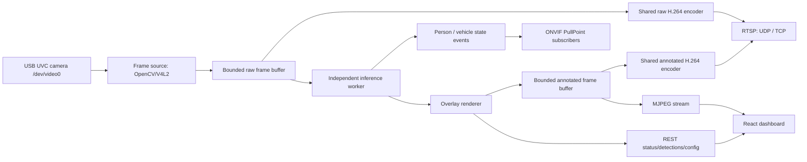

# Architecture

## Runtime Flow

The camera is opened once by the capture worker. Capture and inference use
separate single-slot buffers. Inference failures or slow consumers cannot build a
raw-frame backlog. One shared GStreamer media factory per profile encodes for all
RTSP clients; the pipeline is created on demand and released after clients leave.
Each subscriber has a bounded event queue independent of video delivery.

## Backend

`cybervisual.runtime.RuntimeService` owns the camera source, detector, frame buffer, status, and snapshot lifecycle. Camera and detector creation are lazy so config changes can close/rebuild only the affected object.

`network_camera.server.NetworkCameraService` adds SOAP routes to the same Flask app,
owns the GLib RTSP loop and WS-Discovery worker, and stops them with the runtime.
Frame generations prevent pending inference from republishing frames after a
disconnect, source change, or stop. Persistent device UUID and presets live in
`CYBERVISUAL_STATE_DIR`; credentials come only from the deployment environment.
The [network camera contract](network-camera.md) describes service boundaries and
the replaceable PTZ driver interface. Run one process per physical camera; multiple
WSGI workers would each attempt to open the camera and bind the protocol ports.

Frame sources:

- `OpenCVCamera` for USB UVC devices through V4L2.
- `VideoFileCamera` for sample-video integration testing.
- `SyntheticCamera` for local development without Jetson hardware.

Detector backends:

- `TensorRTYOLODetector` loads `.engine` files through JetPack TensorRT/PyCUDA and parses common YOLOv8 COCO output shapes.
- `MockDetector` provides deterministic detections for development, tests, and fallback when `detector_backend=auto` and no engine is present.

## Frontend

The Chinese device console is a React/Vite app with five hash routes: overview,
monitoring, NVR integration, AI events, and settings. Desktop uses a sidebar;
viewports below 1024px use labeled bottom navigation. Each instance manages one
physical camera; external NVR/CyberOS provides recording and playback.

### Source organization

`frontend/src/main.tsx` mounts `app/App.tsx`. The existing app/features/shared
organization is retained; the former single-screen drawer and inspector have
been replaced by dedicated workspaces.

| Module | Responsibility |
| --- | --- |
| `app/` | Navigation, application shell, document visibility, global status coordination |
| `features/runtime/` | Runtime API/types/normalization, overview and device metrics |
| `features/stream/` | MJPEG preview, pause/reconnect/fullscreen and monitoring workspace |
| `features/detections/` | Latest detection contracts and device snapshot requests |
| `features/settings/` | Configuration contracts/defaults, group drafts, save reconciliation and forms |
| `features/network-camera/` | ONVIF/RTSP profiles, readiness, non-secret settings and NVR guidance |
| `features/ptz/` | Shared-controller REST API, hold/release controls, presets and normalized positioning |
| `features/events/` | Current analytics state, bounded recent event log, filtering and pagination |
| `shared/` | Abortable HTTP transport, non-overlapping polling, accessible presentation and common CSS |

Feature APIs own their endpoints and import the shared HTTP transport. Domain
contracts stay in the corresponding feature. `frontend/src/styles.css` remains
the sole stylesheet entry point: shared base and component styles, app and feature
styles, then their responsive overrides. Feature-specific styles and media queries
remain alongside the owning component. No component framework or router is added.

### Data and control lifecycle

Global status refreshes every second while visible. Only monitoring mounts the
MJPEG image and reads detections every second / PTZ every 500ms; only the events
page reads recent events every 2 seconds. Reads wait for completion before
scheduling the next request, abort on cleanup, time out after 5 seconds and expose
independent errors and freshness. Hidden pages release the preview and pause reads.

Applied configuration and drafts are separate. Each group submits only its own
fields; drafts survive navigation and failures. Writes are serialized, a timed-out
write is reconciled by reading the device, and read versions prevent stale responses
from overwriting confirmed saves. Refresh/close warns about unsaved drafts.

PTZ commands use the same controller and persistent presets as ONVIF. Direction
holds renew a fixed 2-second driver lease every 500ms. Release, pointer cancellation,
lost capture, blur, hiding and unmount cancel queued renewals and enqueue stop after
any in-flight command. Reconnecting never restarts a previous movement. The current
simulated driver changes normalized position only, not the physical camera or image.

The backend event broker keeps the newest 200 actual transitions in memory,
independent of ONVIF subscriptions and browser sessions. Initial/synchronized
subscription states do not enter the log. Offline presence is displayed as unknown,
with the last known value retained. Restarting the process clears the history.

Run `npm test` and `npm run build` from `frontend/`. The build refreshes committed
`frontend/dist` assets for Jetson installations that cannot rebuild locally.

## Failure Modes

- Missing OpenCV or disconnected camera sets `health=error`, publishes a placeholder frame, and retries.
- Missing TensorRT engine in `auto` mode falls back to mock detection; explicit `detector_backend=tensorrt` reports an error.
- Automatic mock fallback on a real video source marks ONVIF analytics offline and suppresses AI events and automatic captures. Explicit mock mode and synthetic sources are available for testing.
- Missing protocol dependencies or credentials leave the dashboard running and report `network_camera.state=error`. Discovery failure reports `degraded` while RTSP remains available.
- Camera/inference faults invalidate the corresponding output and report analytics offline. They do not create false disappearance events.
- Invalid config updates return HTTP 400 and do not mutate runtime config.
- Snapshot requests always return an image/JSON pair; if no live frame exists, a placeholder image is saved.
