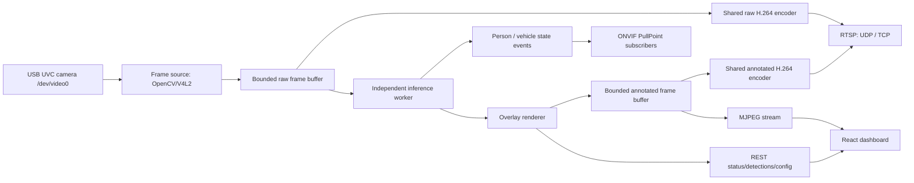

# Architecture

## Runtime Flow

The camera is opened once by the capture worker. Capture and inference use
separate single-slot buffers. Inference failures or slow consumers cannot build a
raw-frame backlog. One shared GStreamer media factory per profile encodes for all
RTSP clients; the pipeline is created on demand and released after clients leave.
Each subscriber has a bounded event queue independent of video delivery.

## Backend

`cybervisual.runtime.RuntimeService` owns the camera source, detector, frame buffer, status, and snapshot lifecycle. Camera and detector creation are lazy so config changes can close/rebuild only the affected object.

`network_camera.server.NetworkCameraService` adds SOAP routes to the same Flask app,
owns the GLib RTSP loop and WS-Discovery worker, and stops them with the runtime.
Frame generations prevent pending inference from republishing frames after a
disconnect, source change, or stop. Persistent device UUID and presets live in
`CYBERVISUAL_STATE_DIR`; credentials come only from the deployment environment.
The [network camera contract](network-camera.md) describes service boundaries and
the replaceable PTZ driver interface. Run one process per physical camera; multiple
WSGI workers would each attempt to open the camera and bind the protocol ports.

Frame sources:

- `OpenCVCamera` for USB UVC devices through V4L2.
- `VideoFileCamera` for sample-video integration testing.
- `SyntheticCamera` for local development without Jetson hardware.

Detector backends:

- `TensorRTYOLODetector` loads `.engine` files through JetPack TensorRT/PyCUDA and parses common YOLOv8 COCO output shapes.
- `MockDetector` provides deterministic detections for development, tests, and fallback when `detector_backend=auto` and no engine is present.

## Frontend

The dashboard is a single React/Vite app. It reads `/stream.mjpg` through an `img` element and polls `/api/status`, `/api/detections/latest`, and `/api/config`. Runtime controls submit partial updates through `PUT /api/config`.

The UI follows a control-console model: large video workspace, compact status bar, detection inspector, class distribution, and runtime settings drawer.

## Failure Modes

- Missing OpenCV or disconnected camera sets `health=error`, publishes a placeholder frame, and retries.
- Missing TensorRT engine in `auto` mode falls back to mock detection; explicit `detector_backend=tensorrt` reports an error.
- Automatic mock fallback on a real video source marks ONVIF analytics offline and suppresses AI events and automatic captures. Explicit mock mode and synthetic sources are available for testing.
- Missing protocol dependencies or credentials leave the dashboard running and report `network_camera.state=error`. Discovery failure reports `degraded` while RTSP remains available.
- Camera/inference faults invalidate the corresponding output and report analytics offline. They do not create false disappearance events.
- Invalid config updates return HTTP 400 and do not mutate runtime config.
- Snapshot requests always return an image/JSON pair; if no live frame exists, a placeholder image is saved.
