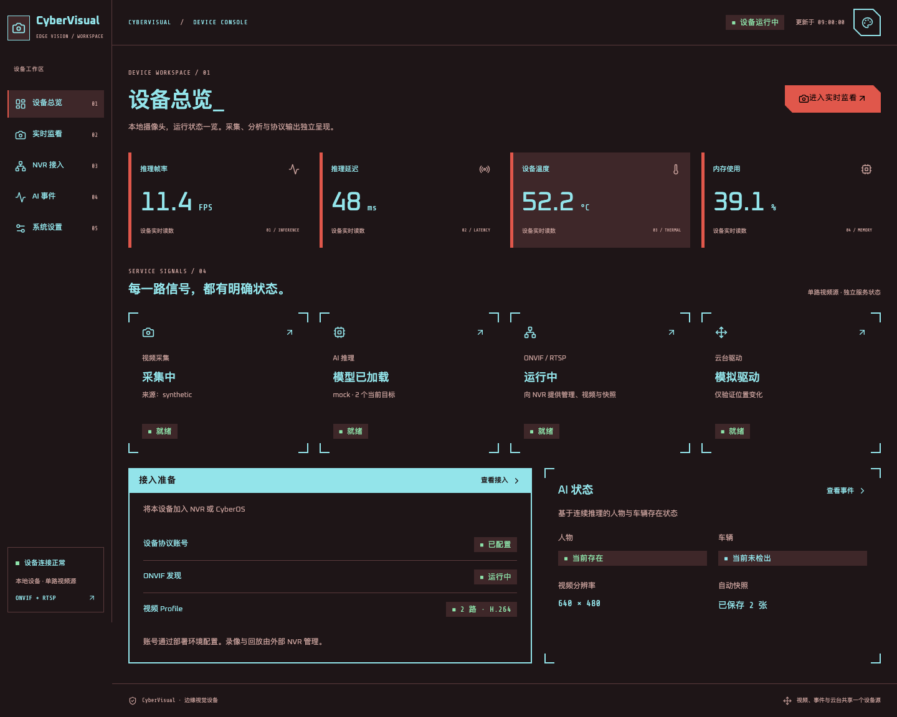
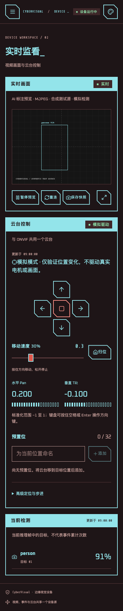

# CyberVisual Web 控制台：CyberUI / ORBIT 规范与验收

日期：2026-11-07。范围仅为五页 Web 控制台、依赖、测试、构建产物与相关文档；不修改后端协议和 3D 教学站，不部署设备。

执行期间，同一工作区出现另一项并行的 PD42S1 云台改动，包括后端、前端类型及设置说明。本次将 Web 重构隔离验证和提交，截图基线及 dist 仅包含本次范围；并行改动原样留在工作区，不归入本次提交。相关驱动实现与硬件效果不属于本次验收结论。

## 固定来源与可追溯性

- 官方仓库：[Arasaka-Academy/CyberUI](https://github.com/Arasaka-Academy/CyberUI)。固定提交：`e31c0355b2b5189c9af1e6e26150f28a44287659`。
- 组件通过官方 GitHub Registry / `shadcn@4.23.0` 安装至 `frontend/src/components/cyberui/`，不引用相邻 CyberUI 检出，也不在运行时加载远程组件。
- `frontend/cyberui.lock.json` 记录 Registry 条目、上游文件位置和 Git blob SHA-1。53 个组件／支持／许可证文件以及 6 个字体／OFL 文件，共 59 个文件与固定提交逐字节一致；单测持续校验，业务适配位于该目录之外。
- MIT 许可证与来源声明保留在组件目录的 `LICENSE`、`UPSTREAM-LICENSE`、`UPSTREAM-NOTICE.md`。字体许可证位于 `frontend/public/fonts/`，构建时一起复制至 `dist/fonts/`。
- ORBIT 的独立参考图保存在 `frontend/e2e/references/orbit-dashboard.png`；来源为同一提交的 `docs/images/readme/dashboard.png`，Git blob 为 `aa5ea4559bd47e249edec3a7165e3e32d273a6d0`，不与应用的新截图混用。
- 排版对照来源为同一提交的 `apps/docs/src/web-scenes/web.module.css`，Git blob 为 `bcb63a8c6c17da39cdffbd9c389a6aceb5267242`。对照的是固定源码，不是会随官方站点更新的页面。

## 设计规范对照

| 规范项 | 官方基准 | CyberVisual 实现与检查 |
| --- | --- | --- |
| 工作台结构 | 侧栏、顶栏、欢迎标题、轨道指标、开放角面板 | 五页共用同一外壳；桌面侧栏 180px、顶栏至少 72px，窄屏改用官方 Drawer |
| 响应式层级 | scene 的 1150 / 850 / 580px 阈值 | 独立全屏控制台按同样宽度设置断点；850px 收起侧栏，580px 重排表单、监看操作和分页 |
| 页面标题 | 桌面 `clamp(24px, 2.4cqw, 38px)`；850px 下 28px；580px 下 27px / 1.5 行高 | 全屏场景使用等价的视口宽度计算；375 / 768 / 1440px 分别断言 27 / 28 / 34.56px |
| 指标排版 | 42px；850px 下 34px；580px 下 38px | 设备总览对应断言 38 / 34 / 42px；移动端隐藏辅助索引，主操作占满标题区 |
| 几何 | 12 / 8px 切角，2 / 1px 描边，16px 开放角，44px 触摸基准 | 使用官方组件 CSS 与 `--cyber-cut`、`--cyber-cut-small`、`--cyber-stroke`、`--cyber-hair`、`--cyber-bracket`、`--cyber-touch`；浏览器逐场景断言变量值 |
| 颜色与语义 | 官方七套配色及各自明暗变量 | 使用官方 Provider / tokens；业务 CSS 不含硬编码色值，不重新定义旧的背景、圆角或控件皮肤 |
| 字体 | Oxanium 与 ShareTechMono | 随应用发布 Oxanium 400 / 600 / 700 与 ShareTechMono 400；不使用在线字体服务；中文按官方字体栈回退系统字体 |
| 基础控件 | Button、Input、Select、Switch、Slider、Progress 等 | 全部复用官方源码；公共适配只负责业务状态、中文说明和错误映射 |
| 面板与反馈 | Panel 的 header / rail / bracket、Badge、Alert、EmptyState | 不再保留旧圆角卡片及另一套按钮／输入／弹层皮肤 |
| 叠层与交互 | Dialog、Drawer、ThemeSwatch、SegmentedControl、主题 Portal | 外观弹层与下拉菜单继承当前变量；覆盖 Escape、焦点约束与恢复、触摸导航 |
| 动效与焦点 | 官方状态时长、2px 焦点环、减少动态效果 | 保留官方实现；浏览器验证焦点样式及 `prefers-reduced-motion` 下的过渡时长 |

这是业务内容替换后的 ORBIT 工作台，不是项目管理示例的逐像素复制。品牌字标为较长的 CyberVisual 做侧栏适配；没有复制项目、成员、完成率曲线或装饰性假指标。页面图标、视频比例、表单密度和事件列数服务于原有设备业务。

## 页面与行为边界

- **设备总览**：四组真实运行读数、采集／推理／协议／云台服务状态、资源与接入准备情况；没有新增无数据来源的图表。
- **实时监看**：视频主区域，云台与当前检测为辅助区域；保留画面比例、暂停、重连、快照、后台暂停与离页释放。主题变化只更新 Provider，不重建页面或视频元素。
- **NVR 接入**：地址与 Profile 说明、接入就绪状态、协议配置与凭据门槛；设备输出就绪不被写成外部 NVR 已连接或已录像。
- **AI 事件**：官方 Table / Pagination / Select，移动端调整列布局；分析离线或数据过期时，存在状态明确显示“未知”，保留最近已知值，不把中断伪装为无人或无车。
- **系统设置**：保留视频源、AI、自动快照、云台的分组保存；跨页草稿、撤销与保存失败保留输入不变，提交只包含当前配置组。
- **云台安全例外**：方向键及停止键的 `HoldButton` 使用官方 `button.module.css` 和切角装饰，但保留原生按钮事件与指针捕获。原有按住续租、松开／取消／失焦／离页停止、请求串行队列和 2 秒租约保护不改成单击操作。
- **兼容性**：后端 API、数据类型、五个 hash 路由及云台设置直达链接均保留；本次不更改服务端访问或认证边界。

## 外观管理

默认 Neon Dark、简体中文。配色为 Neon、Mono、Graphite、Synthwave、Bloodline、Terminal、Amber；显示模式为深色、浅色、跟随系统。

外观保存在当前浏览器的 `cybervisual.appearance.v1`，不写设备配置。跟随系统响应操作系统颜色模式变化；切换外观不重置路由、草稿、暂停状态或视频连接。读取损坏 JSON、未知配色／模式或存储被禁用时，回退 Neon Dark，页面仍可使用；存储写入失败也不会阻止操作。

## 验证与截图策略

验收先对照固定 ORBIT 参考图、官方样式及组件源码，再建立应用基线，不以一次 `--update-snapshots` 的成功作为规范符合证据。

人工查看设备总览桌面／移动、实时监看、NVR、事件与浅色设置页，检查布局、字体、面板几何、状态和视频主次关系。源码对照发现窄屏标题与指标字号不一致后，已按官方 28 / 27px 与 34 / 38px 规则校准，再更新基线。业务内容不同的区域不要求与 ORBIT 的假数据位置重合。

| 检查 | 本地结果与准确边界 |
| --- | --- |
| Vitest | 124 项通过：保留原有 24 项，新增 24 项外观回归与 76 项来源／规范／对比度契约检查；包含损坏存储把模式写成数组时的崩溃回归 |
| 页面截图矩阵 | 5 页 × 7 配色 × 2 明暗 × 375 / 768 / 1440px，共 210 张 macOS 基线；固定时间、固定数据、本地 SVG 测试画面 |
| Playwright | 236 项通过：210 项布局／截图、10 项业务交互、15 项可访问性、1 项原生缩放；最终不带更新参数重跑比较通过，且运行前后源码指纹一致 |
| axe | 70 组桌面页面、14 组外观弹层、1 组移动 Drawer，共 85 次 WCAG A / AA 检查，无 serious / critical 问题；不是完整人工无障碍认证 |
| 配色对比度 | 14 种配色逐一检查正文、辅助文字、强调文字与语义状态在背景／柔和表面上的对比度，以及按钮和反色标题的前景组合，均不低于 4.5:1 |
| 320px 与重排 | 五页均检查 320px、720px 无全页横向溢出；表格可在自身容器内横向滚动，不撑开整个页面 |
| 真正的 200% 缩放 | 独立临时 Chromium 配置和测试扩展调用 `chrome.tabs.setZoom(2)`，读取实际缩放值 2；1440px 物理视口变为 720 CSS px，逐页检查布局、外观弹层、Escape 与焦点恢复。不是 CSS `zoom` 或仅缩小 viewport 的替代测试 |
| 业务生命周期 | 覆盖草稿、分组请求、失败保留、过期／取消／隐藏暂停、预览重连与释放、事件未知状态与筛选／分页、指针及键盘停止、离页停止 |
| 实际后端冒烟 | 1 项通过：独立 Python 环境，synthetic camera + mock detector，`127.0.0.1:8119`；从生产 dist 读取五页，不使用 HTTP mock，验证 MJPEG 实际帧、快照 201、主题不触发配置写入、跨页草稿及真实配置保存／回读／恢复；已停止本次启动的测试服务 |
| 构建 | React / React DOM 19.3.1、Tailwind / Vite 插件 4.3.4、Vite 8.1.5；TypeScript 与生产构建通过，连续两次构建逐文件 SHA-256 相同，已跟踪 dist 同步字体和许可证 |
| 依赖安全 | `npm audit --omit=dev` 为 0；全量审计仍有既有开发工具链的 3 moderate / 3 high，未在本次迁移中升级 Vite／Vitest 或执行自动修复 |

浏览器引擎由锁文件内的 Playwright 1.65.0 管理。默认回归启用减少动态效果；手动审阅仍不能代替读屏器用户测试、所有浏览器或所有触控设备验收。

### 截图位置

- 官方参考：`frontend/e2e/references/orbit-dashboard.png`。
- 可审阅且纳入仓库的 210 张主题截图：`frontend/e2e/snapshots/darwin/{page}-{scheme}-{mode}-{width}.png`。
- 最近一次运行图、axe JSON 附件及 HTML 报告：`frontend/artifacts/test-results/`、`frontend/artifacts/playwright-report/`。
- 无 HTTP mock 的实际后端截图和证据：`frontend/artifacts/smoke-results/`、`frontend/artifacts/smoke-report/`。





## 复现命令

在仓库根目录执行前端检查：

```bash
npm --prefix frontend ci
npm --prefix frontend test
npm --prefix frontend run build
npm --prefix frontend exec playwright install chromium
npm --prefix frontend run test:e2e
git diff --exit-code -- frontend/dist
```

只有在对照固定官方来源并确认差异符合设计后，才更新基线：

```bash
npm --prefix frontend run test:visual -- --update-snapshots
npm --prefix frontend run test:e2e
```

基线按 `{platform}` 隔离。macOS 的中文 PingFang 与 Linux 系统字体渲染不同，不能将本机 PNG 与另一平台直接比较。当前 CI 在 Linux 使用 `CYBERVISUAL_CAPTURE_ONLY=1`：仍执行全部布局、字体栈、颜色、几何、交互、axe 和原生缩放断言，并生成截图供审阅；**不宣称 Linux 已通过 macOS 像素基线比较**。Linux 视觉基线需要在相应环境按同样的官方对照流程单独批准。

CI 保留原有 `git diff --exit-code -- dist` 一致性检查，并上传浏览器报告 14 天。本节记录匹配 CI 的 Node 22 环境中的本机结果；远端 GitHub Actions 的状态以对应提交的工作流为准，不以本机通过代替远端成功。

### 隔离的实际后端冒烟

使用独立临时配置与截图目录，避免修改正在使用的设备配置。以下命令应在一个空闲端口启动服务，且网络摄像头协议保持关闭：

```bash
SMOKE_DIR=$(mktemp -d)
python3.12 -m venv "$SMOKE_DIR/venv"
"$SMOKE_DIR/venv/bin/pip" install -r backend/requirements.txt
PYTHONPATH="$PWD/backend" CYBERVISUAL_SOURCE=synthetic CYBERVISUAL_DETECTOR=mock \
  CYBERVISUAL_HOST=127.0.0.1 CYBERVISUAL_PORT=8119 \
  CYBERVISUAL_NETWORK_CAMERA=false CYBERVISUAL_DISCOVERY_ENABLED=false \
  CYBERVISUAL_CONFIG="$SMOKE_DIR/config.json" CYBERVISUAL_CAPTURE_DIR="$SMOKE_DIR/captures" \
  CYBERVISUAL_FRONTEND_DIST="$PWD/frontend/dist" "$SMOKE_DIR/venv/bin/python" -m cybervisual
```

另一个终端执行；测试会检查 synthetic / mock 与关闭的协议状态，然后仅往该临时配置写入一次 AI 阈值并恢复：

```bash
CYBERVISUAL_LIVE_URL=http://127.0.0.1:8119 npm --prefix frontend run test:smoke
```

不要把这个会写入配置的冒烟命令指向生产设备。测试结束后停止自己启动的测试服务。

## 尚未覆盖的验收

- 没有在 Jetson 上部署，也没有确认实体摄像头、TensorRT 模型、硬件编码、机械云台、设备重启或外部 NVR 的真实接收与录像。
- synthetic / mock、浏览器请求和 UI 自动化只能证明本地软件行为，不能作为实体设备验收。
- 本次未重跑后端协议互通全量；后端源码和协议未修改，既有协议验收记录不等于本次硬件验收。
- 生产 JS 约 520KB，gzip 约 163KB，保留 Vite 的大于 500KB 非阻断提示；没有为消除警告引入额外分包改造。
