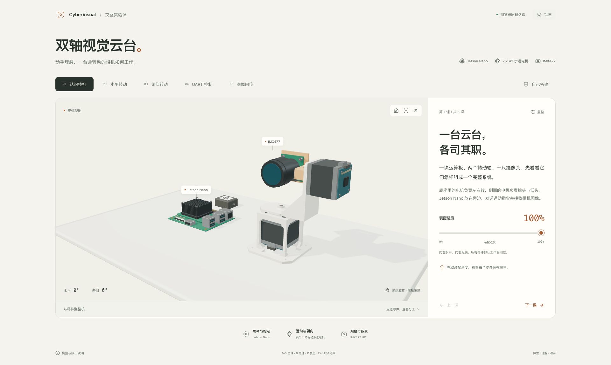

# Jetson Nano 双轴视觉云台 · 3D 交互课

中文浏览器课件：Jetson Nano 通过 UART 给两个微雪 42 mm 一体驱动步进电机发送目标，顶部 IMX477 相机通过 CSI 回传图像。五节课程和一个搭建实验共用同一份运动与采集状态。

[在线打开课件](https://arasaka-academy.github.io/CyberVisual/lesson/) · [下载离线 HTML](https://arasaka-academy.github.io/CyberVisual/lesson/lesson.html) · [站点首页与装配图](https://arasaka-academy.github.io/CyberVisual/)



## 直接打开

用支持 WebGL 的桌面浏览器打开 **[app/dist/lesson.html](app/dist/lesson.html)**。这是约 2.82 MB 的离线单文件，已嵌入程序、模型与样式，不需要服务器或网络。`dist/` 为本地构建产物，重新检出工程后请先执行下方构建命令。

普通静态站点版本在 `app/dist/`，入口为 `index.html`；发布时保留整个目录。课件使用相对资源地址，可以放在站点子目录。

## 本地运行与构建

需要 Node.js **22.12 或更高版本**、npm 和支持 WebGL 的现代浏览器。此工程独立于仓库原有检测控制台，无需启动 Python 后端。

```bash
cd /Users/zhubby/Repository/CyberVisual/viz-jetson-pan-tilt/app
npm ci
npm run dev
```

默认地址为 <http://127.0.0.1:5420/>。端口被占用时会明确退出，不自动换端口。

```bash
npm run build
npm run preview
```

构建同时生成普通静态站点和 `dist/lesson.html`。预览同样使用 5420 端口；请先停止开发服务器。

## 操作

| 课程 | 主要操作 | 观察重点 |
| --- | --- | --- |
| 认识整机 | 装配进度滑块 | 底座、电机、支架和相机从托盘归位，Nano 留在旁边负责控制与处理 |
| 水平转动 | 水平角度滑块 | 上座、侧面电机与整个相机组件一起绕竖直轴转动 |
| 俯仰转动 | 俯仰角度滑块 | 上座与电机机身保持原位，输出轴、托架与相机转动 |
| UART 控制 | 发送双轴目标 | 先显示指令传递，再运动到水平 +30°、俯仰 +15° |
| 图像回传 | 采集一帧 | 在当前姿态曝光，经过 CSI 回传后显示对应虚拟图像 |
| 自己搭建 | 放设备、连接口、运行 | 检查组装、UART、CSI 和电机供电；停止后角度与已采集帧冻结 |

搭建实验中，拖动零件到三维工作台，或点击零件按钮即可放置。点击一个接口再点击另一个接口可连接，也支持拖动连接。错误会指出缺失设备、缺失电源或接口类型不匹配；用连接列表右侧的移除按钮修改线路。

模型支持鼠标拖动旋转、滚轮缩放、触控旋转和双指缩放；右上方提供三分之四、正视与俯视视角。点选模型查看零件分工。浅色、石墨与蓝图主题会同时调整界面和三维场景，选择保存在本地。

键盘：`1–5` 切换课程，`6` 打开搭建实验，`R` 复位，`Esc` 取消零件选择或关闭说明窗口。`Tab` 移动焦点，`Enter` / `Space` 操作按钮，方向键与 `Home` / `End` 调整滑块。输入控件内保留原生键盘行为。系统启用“减少动态效果”时，运动与回传直接呈现结果。

切换课程会恢复该课程的初始姿态，并取消上一课尚未完成的指令或采集。复位搭建实验会清空设备、连接和已采集图像。

## 验证

```bash
cd /Users/zhubby/Repository/CyberVisual/viz-jetson-pan-tilt/app
npm test
npm run build
```

浏览器验收需要 Chromium，并且开发服务器已经在 5420 运行。在另一个终端执行：

```bash
npx playwright install chromium
npm run test:browser
```

已有兼容 Chromium 时脚本会优先使用 Playwright 的安装路径及常规缓存，也可用 `LESSON_BROWSER_PATH=/绝对路径/Chromium` 指定可执行文件。`LESSON_URL` 可覆盖默认地址，`LESSON_EVIDENCE_DIR` 可指定独立的报告/截图目录，用于线上验收。浏览器脚本默认重新生成 `evidence/browser-report.json` 和课程截图，包含断网直接打开离线文件的检查。

Pages 会在 `main` 上的课件变更后自动构建并发布，入口为 `/CyberVisual/lesson/`。完整站点的构建与验证流程见 [Pages 发布说明](../docs/figure-pages.md)。

验收范围、截图索引与发现的问题见 [ACCEPTANCE.md](ACCEPTANCE.md)。

## 结构与资产

| 路径 | 用途 |
| --- | --- |
| `TOPIC.md` | 课程主题、视觉参考、尺寸假设和验收计划 |
| `blender/build_assets.py` | 复用原 CAD 网格并生成 Nano、示意驱动器和电源 |
| `blender/assets.blend` | 可编辑模型源文件 |
| `blender/ASSETS.md` / `blender/refs/assets.md` | 节点层级、坐标、来源与尺寸依据 |
| `app/public/assets/` | 三个 GLB、节点目录和静态降级图 |
| `app/src/simulation.mjs` | 课程、角度、指令、曝光与搭建实验的纯状态转换 |
| `app/src/kinematics.mjs` | 两轴变换、光轴与接口锚点 |
| `app/src/store.mjs` | 以 1/60 秒步长推进的共享状态 |
| `app/src/Scene.jsx` | 装配动画、运动层级、跟随锚点的线路和视角 |
| `app/src/Snapshot.jsx` | 用同一曝光姿态驱动独立三维相机，渲染虚拟标定场景 |
| `app/tests/` | 状态、实际 GLB 层级与浏览器验收 |

原装配的 **57 个 CAD 零件**来自 `../models/imx477-hq/figure/scene.json`，保留原始三角面。`PanPivot` 带动上层整体，`TiltPivot` 位于高度 126 mm 的横轴，`TiltRotor` 随电机轴转动。相机和线路锚点使用相同父子变换；线缆为示意柔性曲线。

需要重建资产时使用 Blender 3.6 或兼容版本，在本工程目录执行：

```bash
blender --background --factory-startup --python blender/build_assets.py
```

脚本会更新 GLB、目录、`.blend` 和预览图。构建后的 GLB 已随工程提供，日常运行无需 Blender。来源与依赖致谢见 [CREDITS.md](CREDITS.md)。

## 教学边界

这是浏览器原理仿真。水平 **±90°**、俯仰 **±35°** 为教学范围；52° 视场是示例假设，图像来自虚拟标定场景。

电机具体型号尚未提供，驱动器外形和 Nano 接口位置为参考示意。两条 UART 线路表达逻辑控制关系，不代表指定硬件有两路可直接使用的物理串口。语义运动指令不对应厂商协议；真实引脚、电平、波特率、地址、供电、CSI 驱动兼容性及线缆弯折空间需按实物资料核对。Nano 在实验中默认已有独立供电，搭建检查针对电机电源。

本轮未访问真实串口或相机，也未验证实体负载、限位、安装公差与供电。现有 CAD 打印件沿用原项目设计，新增电子件外形不作为生产或采购尺寸依据。
